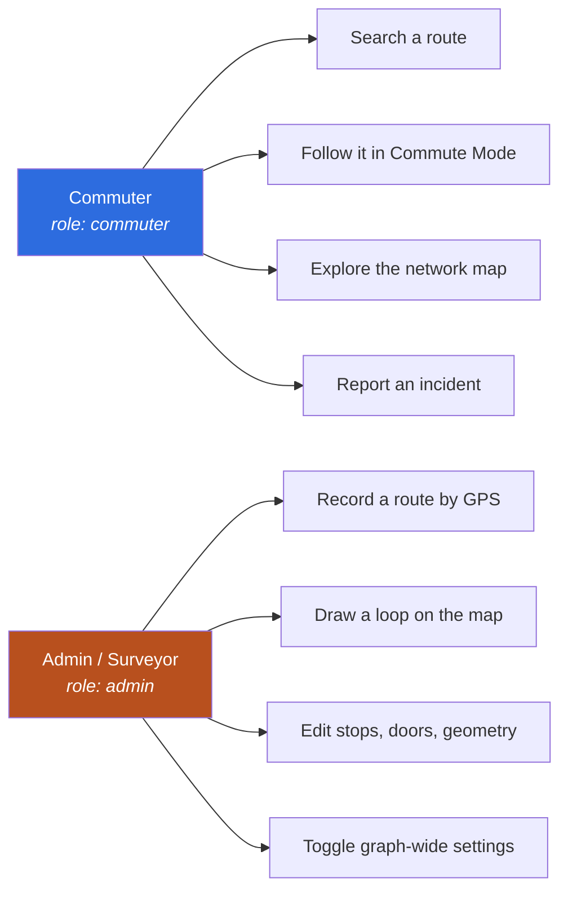

# 1. Overview

## What Gora is

A commuter opens Gora, types where they are and where they want to go, and gets two or three
ranked door-to-door itineraries: walk 300 m to the jeepney stop, ride to Crossing, transfer to
MRT-3, ride to Ayala, walk 450 m to the office. Each itinerary carries a fare in pesos, a
duration adjusted for peak hours, and a map polyline that follows the actual road and
pedestrian geometry.

What separates it from a generic map app is the data: Metro Manila's jeepney and tricycle
network is not in any public feed. Gora carries its own transit graph, and ships the tools to
grow it — a GPS route recorder, a loop creator, and an in-app admin editor.

## Who uses it

Role lives on the `users.role` enum server-side (`commuter` = 0, `admin` = 1) and gates the
Admin tab client-side via `UserSession.isAdmin` (`Gora/Services/UserSession.swift:14`).

## The five tabs

| Tab | Entry view | Purpose |
|---|---|---|
| Commute | `Views/Commute/ContentView.swift` | Search, compare routes, enter Commute Mode |
| Explore | `Views/Explore/ExploreView.swift` | Browse the whole network on a map |
| Record | `Views/Record/RecordCommuteView.swift` | GPS-record a new route; loop creator; polyline recorder |
| Admin | `Admin/AdminRoutesView.swift` | *(admin only)* edit routes, stops, edges, settings |
| Settings | `Views/Settings/SettingsView.swift` | Profile, sign out |

Assembled in `Gora/GoraApp.swift:24`.

## Core capabilities

- **Multimodal A\* routing** over train / bus / jeepney / tricycle / walk, with walk always
  permitted regardless of the user's mode filter.
- **Three simultaneous strategies** — fastest, cheapest, balanced — deduplicated into up to
  three distinct options per search.
- **Coordinate endpoints.** Origin and destination need not be stations. A dropped pin, a GPS
  fix or a geocoded address becomes a virtual node wired into the graph with synthetic
  "access walk" edges.
- **Station doors.** A station can carry multiple access points (entrances/exits, optionally
  direction-tagged) so a walk is measured to the door a passenger actually uses, not the
  station centroid.
- **Real pedestrian geometry.** Straight-line walks are good enough to *search* with; every
  surviving walk leg is re-measured against MapKit walking directions after results render.
- **Peak-hour awareness** via per-mode multipliers from the graph.
- **Operating hours** enforced (or not — it's a server-side switch) per station.
- **Over-the-air graph updates** — the graph is downloaded from the backend and cached, not
  bundled.
- **Commute Mode** — a follow-along mode with live leg progress and a 2D/3D map camera.

## Glossary

| Term | Meaning |
|---|---|
| **Station** | A node in the graph. Not necessarily a rail station — a jeepney stop is a station. Text primary key, e.g. `MRT_NORTH_AVE`, `UPLB_KANAN_STOP3`. |
| **Edge** | A directed ride between two stations on one line. May be `bidirectional`, in which case the engine synthesises the reverse at load time. |
| **Line** | A named service, e.g. `MRT-3`, `EDSA_BUS`, `UPLB_KANAN`. Groups stations and edges. |
| **Mode** | `train`, `bus`, `jeepney`, `tricycle`, `walk`. Defined as data in `transportModes`, never hardcoded. |
| **Leg** | One continuous ride the user is shown. Built by consolidating consecutive A\* edges on the same line. |
| **RawStep** | One A\* edge. Internal; never surfaced directly. |
| **Access walk** | Synthetic edge (`line: "ACCESS_WALK"`) between a coordinate endpoint and a real stop. |
| **Interchange** | Edge with `line: "INTERCHANGE"` — a recorded transfer walk. Never merged into a ride leg, skips fare and operating-hours checks. |
| **Access point / door** | A specific entrance or exit of a station, with its own coordinates. |
| **Graph version** | Integer on `graph_meta`, bumped on every mutation. Drives OTA sync. |

## Naming note

The Xcode project, scheme, target and source directory are all `Gora`, matching the product
name and the `com.banaueinc.gora` bundle ID.

The app was previously called **CommuteBeh**, and that name survives in three places: the
git repository and its containing folder, the backend repo `commutebeh-rails`, and the
frozen audit/findings documents at the repo root. Expect it in history, not in current code.
