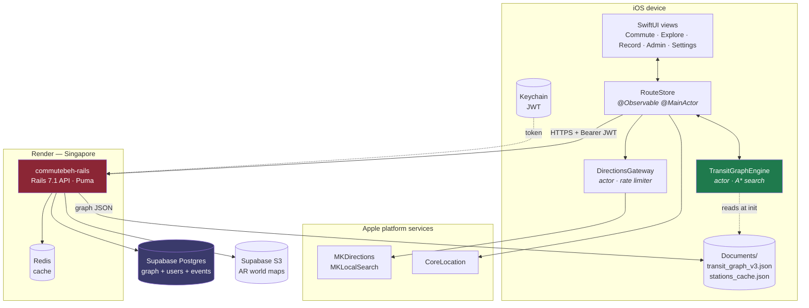
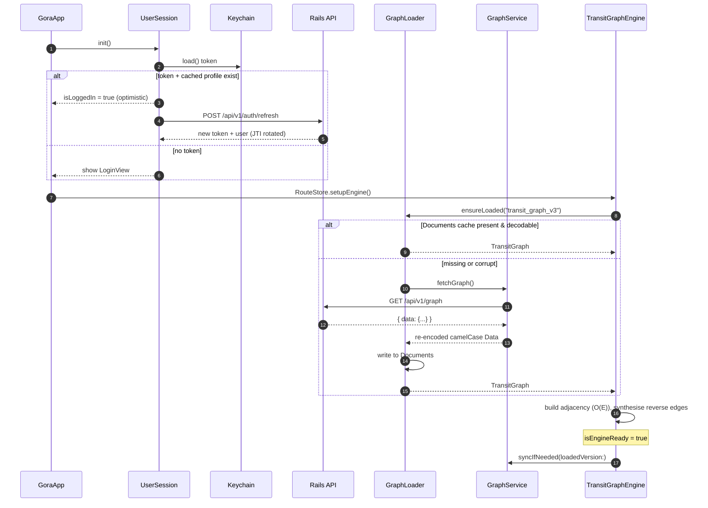
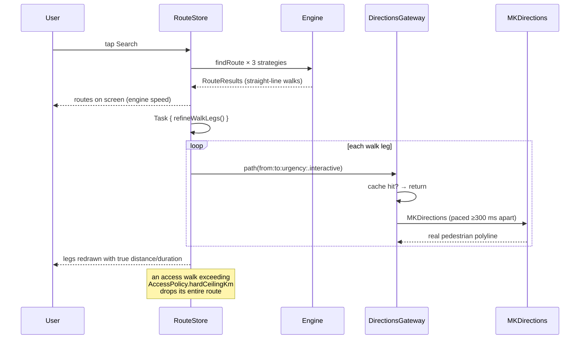
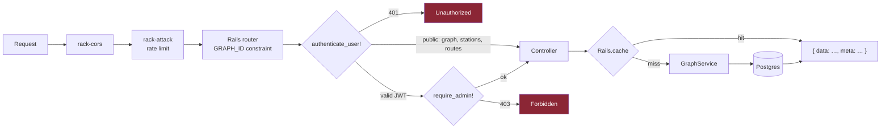
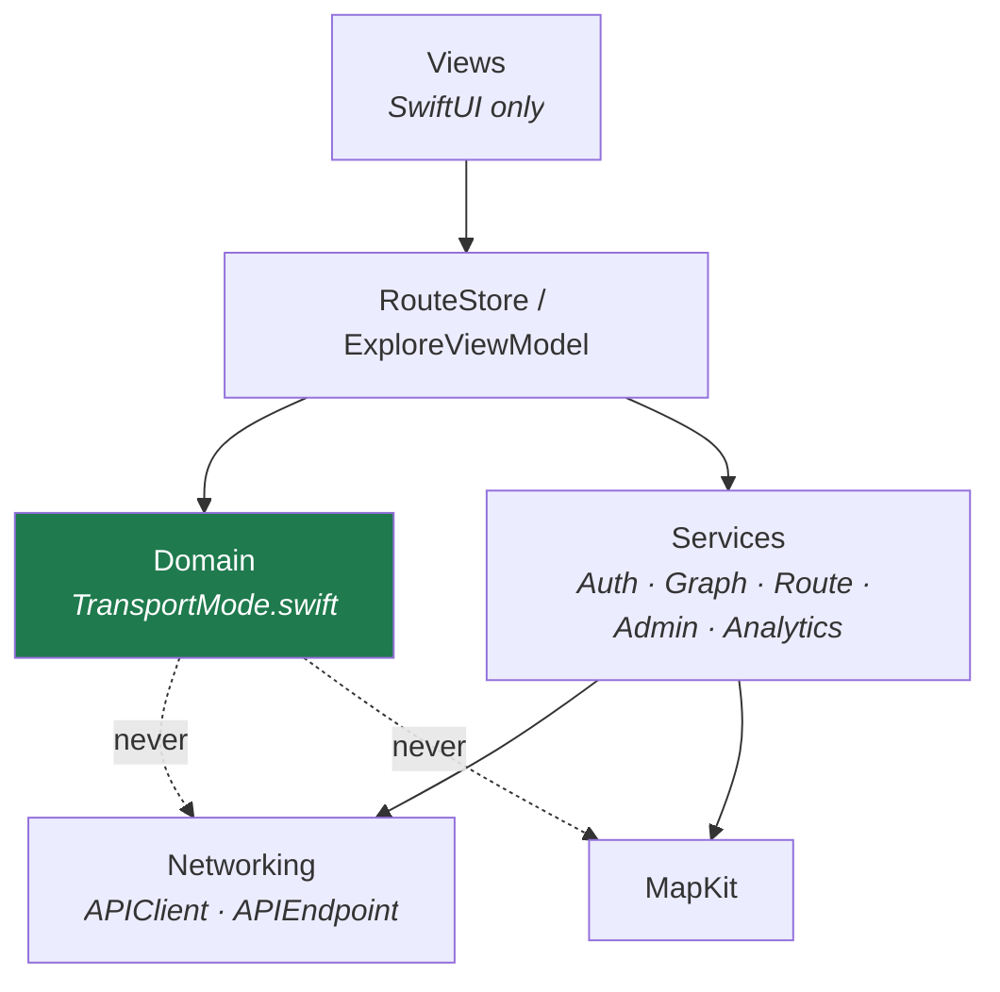

# 2. Architecture

## System context



Two things to internalise from this diagram:

1. **Routing is entirely client-side.** The server never computes a path. It is a graph
   authoring and distribution service plus an identity provider. This is why the app still
   routes with no connectivity once the graph is cached.
2. **The graph is not bundled.** `Gora/Resources/` is empty. The only copy on device is
   the one downloaded into `Documents/` (see [8. Graph Sync](08-graph-sync.md)).
   **Drift:** `CLAUDE.md` still describes a bundled `transit_graph_v3.json`.

## Cold start



Note the optimistic login at step 3: the UI shows the cached profile immediately and refreshes
the token behind it. If the refresh comes back 401, `UserSession.clearSession()` drops the user
back to `LoginView`.

## Concurrency model

Swift Concurrency throughout. No Combine, no `ObservableObject`.

| Type | Isolation | Why |
|---|---|---|
| `RouteStore` | `@MainActor` `@Observable final class` | Drives SwiftUI directly |
| `TransitGraphEngine` | `actor` | Immutable adjacency, but serialises search; keeps CPU work off main |
| `DirectionsGateway` | `actor` | Owns a single shared clock + cache for all MKDirections calls |
| `AccessPolicy` | `nonisolated enum` | Pure constants read from inside the engine's actor |
| Models (`Station`, `TransitEdge`, `RouteResult`, …) | immutable `Codable` structs | Freely `Sendable` across boundaries |

The three cost strategies are dispatched as concurrent child tasks:

```swift
async let r1 = engine.findRoute(req1)   // .fastest
async let r2 = engine.findRoute(req2)   // .cheapest
async let r3 = engine.findRoute(req3)   // .balanced
let (fr, cr, br) = await (r1, r2, r3)
```

They serialise through the actor's executor but the caller suspends once for all three
(`Domain/TransportMode.swift:1834`).

## The refinement pass

The single most distinctive piece of the runtime design: results are published *before* they
are accurate, then sharpened.



Why it exists, from `Services/WalkRouteRefiner.swift:18`: a stop 400 m away across a river or a
walled campus is *a 400 m estimate and a 1.8 km reality*. Straight lines are fine as search
input, useless as walking instructions.

Why the gateway exists, from `Services/DirectionsGateway.swift:12`: Apple rate-limits
MKDirections at roughly 50/60 s per app, and once exceeded it reports
`MKError.directionsNotFound` — indistinguishable from "there is genuinely no path here".
Explore's road-snapping pass could burn the whole quota in seconds and silently strip geometry
off every walk leg in a search the user was waiting on. One actor now paces every caller, with
`.interactive` (300 ms spacing) prioritised over `.background` (1200 ms).

## Server request pipeline



The `GRAPH_ID = /[^\/]+/` router constraint deserves a note. Graph IDs are author-supplied and
can contain dots — the line `STACRUZ.LRT_BUENDIA`, for instance. Rails' default dynamic segment
stops at a dot and hands the rest to `:format`, so
`DELETE /admin/graph/routes/STACRUZ.LRT_BUENDIA` arrived as `line_id: "STACRUZ"`,
`format: "LRT_BUENDIA"` — deleting nothing while reporting success. Every route carrying a
graph ID now uses this constraint plus `format: false` (`config/routes.rb:15`).

## Layering rules



The domain layer imports `Foundation` and `CoreLocation` only. MapKit is deliberately kept out
of it — this is why walk refinement lives in `Services/WalkRouteRefiner.swift` as an extension
on `RouteStore` rather than inside the engine.
