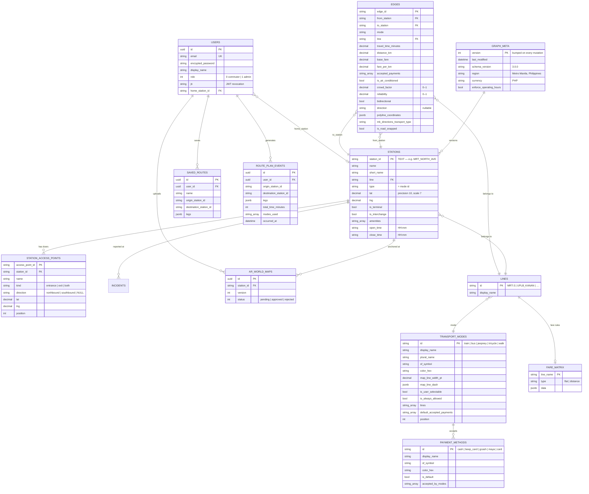
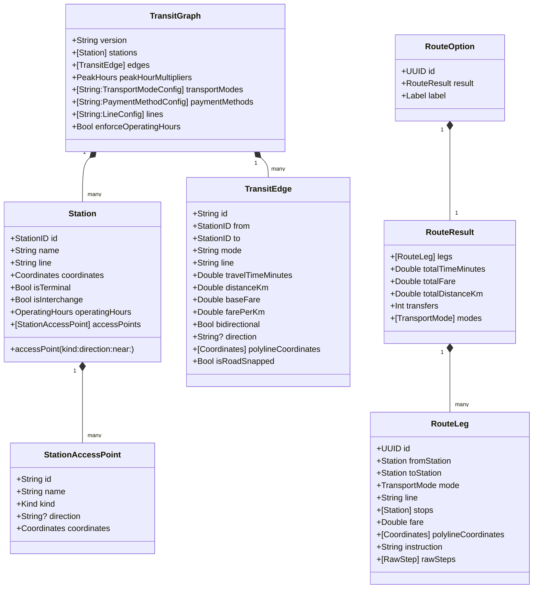

# 3. Data Model

The transit graph exists in two representations that must stay in lockstep:

- **Postgres**, normalised — the authoring source of truth, in `commutebeh-rails`.
- **JSON**, denormalised — one document assembled by `GraphService.assemble_graph`, served by
  `GET /api/v1/graph`, cached on device and decoded into Swift structs.

## Entity relationships (Postgres)



### Primary key convention

`stations`, `edges`, `station_access_points`, `transport_modes`, `payment_methods`, `lines` and
`fare_matrix` all use **author-supplied TEXT primary keys**, not surrogate integers. This is
deliberate: the ID is part of the data contract with the client and appears in URLs, saved
routes and analytics rows.

Consequences worth knowing:

- Rails models declare `self.primary_key` explicitly (`app/models/station.rb:2`).
- `Station` and `Edge` set `self.inheritance_column = nil` because both have a real `type`
  column that has nothing to do with STI.
- IDs can contain dots — hence the `GRAPH_ID` router constraint (see
  [2. Architecture](02-architecture.md#server-request-pipeline)).
- There is **no DB-level FK** from `saved_routes` / `route_plan_events` / `ar_world_maps` /
  `incidents` to a station ID. Stop renumbering can therefore orphan those references — an
  accepted tradeoff documented at `app/services/graph_service.rb:344`.

## The JSON document

`GET /api/v1/graph` returns this shape (assembled at `app/services/graph_service.rb:626`,
decoded by `TransitGraph` at `Domain/TransportMode.swift:292`):

```jsonc
{
  "version": 42,                       // Int from server; String once re-encoded locally
  "lastModified": "2026-08-10T09:12:33Z",
  "enforceOperatingHours": true,
  "metadata": {
    "region": "Metro Manila, Philippines",
    "currency": "PHP",
    "schemaVersion": "3.0.0",
    "polylineNote": "polylineCoordinates define the static display shape of each edge…"
  },
  "transportModes": { "train": { …TransportModeConfig }, "walk": { … } },
  "paymentMethods": { "cash": { …PaymentMethodConfig } },
  "lines":          { "MRT-3": { "id": "MRT-3", "displayName": "MRT-3"} },
  "peakHourMultipliers": {
    "morningPeak": { "startHour": 6, "endHour": 9, "multiplier": 1.4, "appliesTo": ["bus","jeepney"] },
    "eveningPeak": { … },
    "trainPeak":   { … }
  },
  "fareMatrix": { "MRT-3": { … } },
  "stations": [{ …Station } ],
  "edges":    [{ …TransitEdge } ]
}
```

### Decoding tolerances

`TransitGraph.init(from:)` is deliberately forgiving, because a cached graph on a user's device
may predate a schema addition:

| Field | Tolerance | Reason |
|---|---|---|
| `version` | `Int` **or** `String` | Server emits Int; local re-encode emits String |
| `lines` | missing → `[:]` | Added after the first shipped graphs; missing entry falls back to the raw line ID |
| `enforceOperatingHours` | missing → `true` | Backwards-compatible default |

Add new graph fields the same way — `decodeIfPresent` with a safe default. A required field
added carelessly bricks every cached graph in the field, because `GraphLoader` has no bundle
fallback to recover to.

### Key naming

The server emits **camelCase inside the graph document** (`GraphService#station_json` /
`#edge_json`), so `GraphLoader` decodes it with a plain `JSONDecoder`. Every *other* endpoint
is snake_case and goes through `APIClient`'s `.convertFromSnakeCase` decoder. Both conventions
are live simultaneously — check which side of the line you're on before adding a field.

## Swift domain types



`RouteLeg.id` is a transient `UUID()` generated per search — **every other ID in the system
comes from the data**. `RouteOption.id` is likewise a `UUID`, but it is deliberately *carried
through* the walk-refinement rebuild so that selection state and card layout survive
(`Domain/TransportMode.swift:489`).

## Reserved line identifiers

Two line values are control flags rather than real services:

| Value | Meaning | Behaviour |
|---|---|---|
| `INTERCHANGE` | A recorded transfer walk between two stations | Never merged into a ride leg; skips fare and operating-hours checks |
| `ACCESS_WALK` | Synthetic walk from a coordinate endpoint to a stop | Generated at search time, never stored; cost is multiplied by `AccessPolicy.discomfortFactor` |

## Invariants

These hold across both tiers. Breaking one produces subtle, hard-to-trace bugs.

1. **No hardcoded transit data in Swift.** Station names, fares, coordinates, mode strings and
   payment strings all come from the graph.
2. **`alwaysAllowedModes` is derived from data**, not from the literal `"walk"` — the engine
   reads `isAlwaysAllowed: true` out of `transportModes` at init
   (`Domain/TransportMode.swift:723`).
3. **Polyline stitching drops the first coordinate of each subsequent segment** — it duplicates
   the shared junction point.
4. **A stitched leg's polyline endpoints are pinned to the boarding/alighting station
   coordinates**, overriding whatever the stored geometry said. Live data drifts, and the map
   draws pins from station coordinates; a mismatch renders as a visible gap.
5. **Fare is computed once per leg** (single boarding), never summed per edge — that is what
   makes distance-bracketed rail fares come out right.
6. **`isTerminal` is assigned server-side** from stop index, never trusted from a client.
7. **Reverse edges are synthetic.** A `bidirectional` edge produces one stored row and one
   in-memory reverse at engine init, with the polyline reversed and the direction label
   flipped (`northbound` ⇄ `southbound`).
