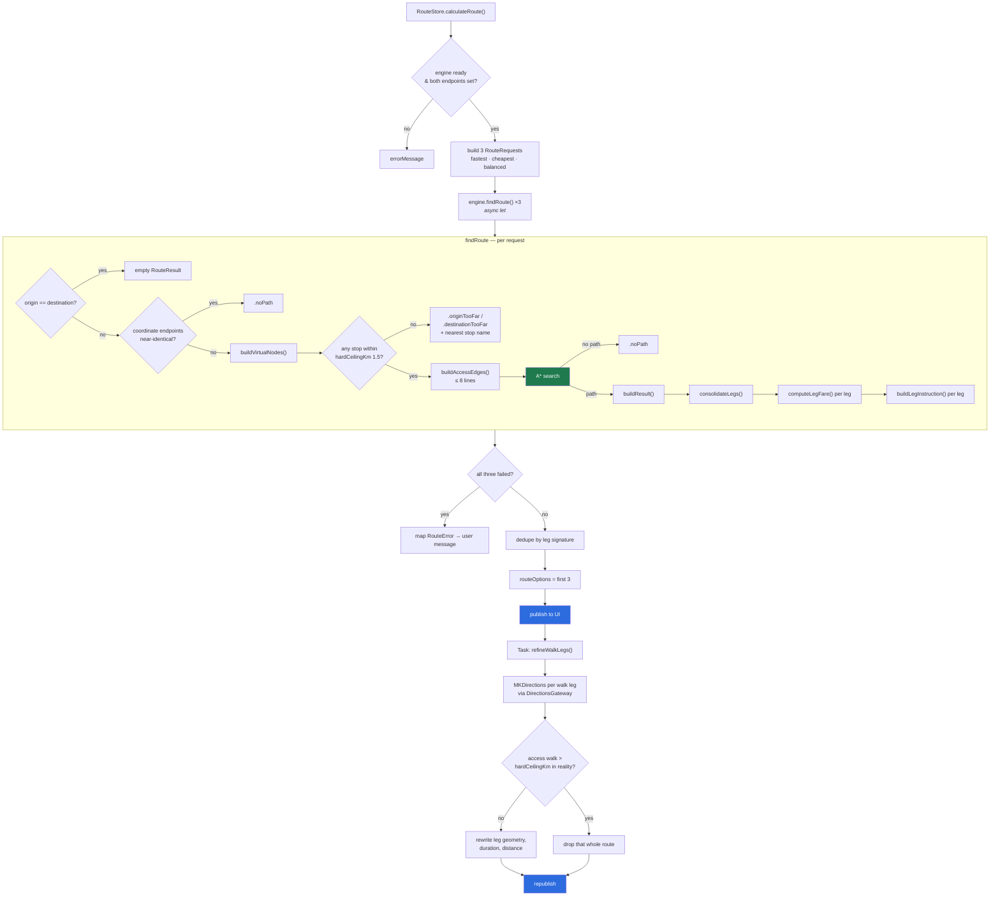
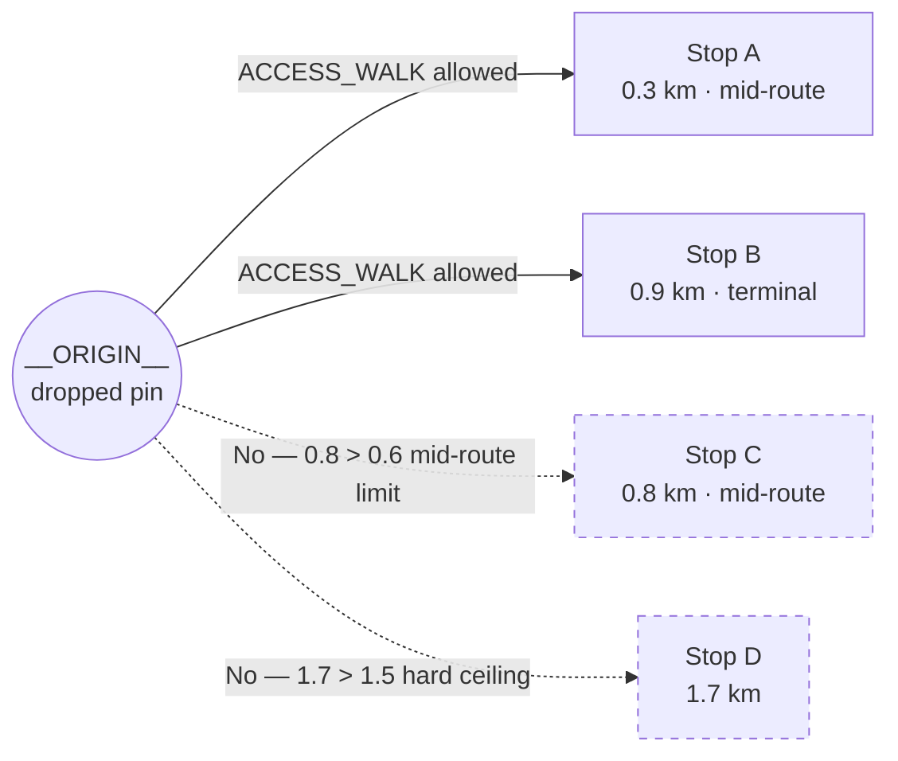
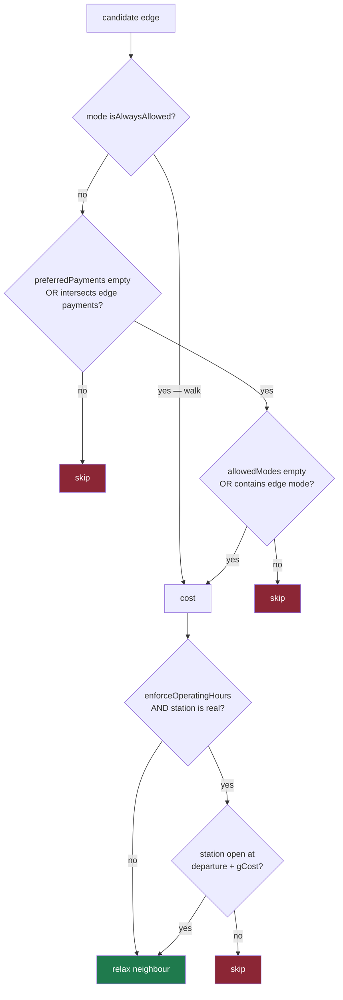
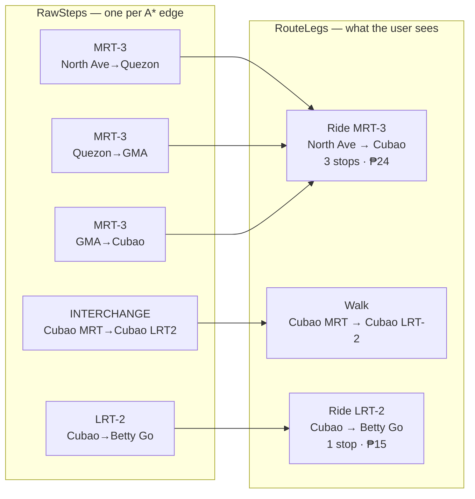

# 4. Routing Engine

Everything here lives in `Gora/Domain/TransportMode.swift`, in the `TransitGraphEngine`
actor (line 643 onward). The file is misleadingly named — it is the entire domain layer, ~2000
lines.

## Pipeline



## Graph construction

At `init(graph:)` the engine builds, in O(E):

- `adjacency: [StationID: [TransitEdge]]` — outgoing edges per station
- `stationMap: [StationID: Station]`
- a synthetic reverse edge for every `bidirectional` edge, with `polylineCoordinates`
  reversed and the direction label flipped
- `alwaysAllowedModes` — derived from `isAlwaysAllowed: true` in `transportModes`
- `enforceOperatingHours` — copied off the graph

All of it is immutable afterwards, which is what lets three concurrent searches share it safely.

## Virtual nodes and access walks

When the user's origin or destination is a coordinate rather than a station, the engine injects
a virtual station (`__ORIGIN__` / `__DEST__`) and wires it into the graph with synthetic
`ACCESS_WALK` edges. This is what makes door-to-door routing work at all.



### AccessPolicy

`Domain/TransportMode.swift:594`. Role-aware rather than a flat radius:

| Constant | Value | Meaning |
|---|---|---|
| `midRouteKm` | 0.6 km | Comfortable walk to an ordinary stop |
| `terminalKm` | 1.2 km | Terminals earn more — walking to a terminal is normal behaviour |
| `hardCeilingKm` | 1.5 km | Past this the location simply isn't served; user is told so explicitly |
| `discomfortFactor` | 1.6 | Search-cost weight on access walks (display duration stays honest) |
| `maxLines` | 8 | Cap on distinct lines getting an access edge, to bound the frontier |
| `walkSpeedKmPerMin` | 4.5 km/h | |
| `detourFactor` | 1.3 | Straight-line → approximate street distance |

The policy replaced a flat 1.5 km radius over the *k nearest stops globally*, which failed in
both directions: it accepted 1.4 km walks to arbitrary mid-route stops, and — because the
nearest stops around any dense point all belong to the same line — it could hand every access
edge to one line and report "no route" for a trip that plainly exists.

The **`maxLines` cap is per line, not per stop**, for exactly that reason. Diversity of lines
beats proximity of stops.

### Doors

If the target station has recorded access points, the walk is measured to the appropriate
door rather than the station centroid — filtered by `kind` (`entrance`/`exit`/`both`) and
`direction`. A `NULL` direction means "serves every direction" and always matches; a `nil`
requested direction means "don't know / don't care" and matches *every* door, so a station whose
doors are all direction-tagged doesn't fall back to its centroid. No doors recorded → centroid.
The selection rule lives in one place: `StationAccessPoint.serving` scope
(`app/models/station_access_point.rb:29`) server-side, `Station.accessPoint(kind:…)`
(`Domain/TransportMode.swift:153`) client-side.

## The A\* search

`Domain/TransportMode.swift:998`.

- **Open set**: `MinHeap<AStarNode>` ordered on `fCost = gCost + hCost`.
- **Heuristic**: Haversine distance origin→destination converted to minutes. Admissible as long
  as the assumed speed is at least the network's fastest.
- **Two parallel score maps**, and this is the subtle part:

  | Map | Contains | Used for |
  |---|---|---|
  | `gScore` | search cost, **includes** the access-walk discomfort weight | frontier ordering |
  | `timeScore` | honest elapsed minutes | everything the user is shown |

  They diverge only on access walks. `buildResult` derives per-leg durations and arrival times
  from `timeScore`, so a weighted walk is never *displayed* as taking longer than it does.

### Per-edge filters, in order



Virtual nodes (`__`-prefixed) bypass the operating-hours check entirely.

### Cost strategies

Let `raw = edge.travelTimeMinutes` and `p = peakMultiplier(edge, departureTime)`.

| Strategy | Effective minutes |
|---|---|
| `.fastest` | `raw × p` |
| `.balanced` | `raw × p + raw × (1 − reliability) × 0.2 + raw × crowdFactor × 0.1` |
| `.cheapest` | `raw × p + fare × 1.5` — fare weighted at 1.5 min per peso; `INTERCHANGE` and `ACCESS_WALK` contribute zero fare |

Then, for the search cost only:

```swift
let searchMinutes = edge.line == "ACCESS_WALK"
    ? effectiveMinutes * AccessPolicy.discomfortFactor   // 1.6×
    : effectiveMinutes
```

Without that weight, A\* will walk 1.2 km to a stop to shave two riding minutes — which no
passenger actually does.

### Peak-hour multipliers

Three windows from the graph — `morningPeak`, `eveningPeak`, `trainPeak` — each with a start
hour, end hour, multiplier, and the list of modes it applies to. `peakMultiplier(for:at:)`
(line 1151) composes them against the request's departure time.

## From path to legs



`consolidateLegs` (line 1272) merges consecutive steps when `canMerge` holds — same `line` and
same `mode`, and **neither side is `INTERCHANGE`**. That last clause is what prevents a transfer
walk from being swallowed into the ride around it.

On flush, each leg gets:

- **stops** = boarding station + every alighting station in the buffer
- **polyline** = all segment coordinate arrays stitched, `dropFirst()` on each subsequent one
  (the shared junction point), then endpoints pinned to the boarding/alighting station
  coordinates
- **duration** = sum of `effectiveTravelMinutes`
- **distance** = sum of `distanceKm`
- **fare** = `computeLegFare(buffer)`
- **instruction** = human sentence built from the *line display name*, never the raw key —
  "Ride the UPLB Kanan jeepney", not "UPLB_KANAN"

### Fare

```swift
guard mode != .walk else { return 0 }
let totalDist = steps.reduce(0) { $0 + $1.edge.distanceKm }
if steps.contains(where: { $0.edge.farePerKm > 0 }) {
    return first.edge.baseFare + totalDist * first.edge.farePerKm
}
return first.edge.baseFare   // flat
```

Computed **once for the whole leg**. A passenger pays one fare at the gate regardless of how
many stations they pass, so summing `baseFare` per edge would multiply an MRT-3 fare by the
number of stops.

## Multiple options

All three strategies run; results are deduplicated on a signature of
`line:fromStation:toStation` per leg, then labelled and truncated to three
(`Domain/TransportMode.swift:1867`). Frequently two or three strategies converge on the same
path, in which case the user sees fewer than three cards — which is correct, not a bug.

## Failure modes

`TransitGraphEngine.RouteError` (line 741), and how `RouteStore` renders each:

| Error | User-facing message |
|---|---|
| `.stationsClosed(closeTime:)` | "Stations are closed. MRT/LRT service ends at 10:00 PM."|
| `.originTooFar(nearest:km:)` | "Your start point isn't served yet — the nearest stop (Stop 3) is 2.1 km away."|
| `.destinationTooFar(nearest:km:)` | "Your destination isn't served yet — the nearest stop (…) is … away."|
| `.noPath` | "No route found between these locations."|

The `TooFar` cases carry the nearest stop and its distance specifically so the UI can say *why*
rather than a bare "no route". When you add a failure mode, carry the diagnostic with it.

## Walk refinement

`Services/WalkRouteRefiner.swift`. Runs after publish, never before.

Every walk leg arrives as a straight line — access walks measured as haversine × 1.3, and
interchange walks as two-point chords straight out of the JSON. Both are fine as *data*; neither
is a path anyone can follow. Each is re-measured against real MKDirections pedestrian geometry
and rewritten with true duration, distance and street-following polyline.

Two rules govern the result:

- An **access walk** whose real distance blows past `hardCeilingKm` **takes its whole route with
  it** — that route was only ever offered on the strength of a straight line.
- An **interchange walk** is never grounds for dropping a route. It is the network's own recorded
  transfer, not something inferred from a pin the user dropped.

The task bails without touching state if `routeOptions` changed while measuring — the user
picked a route, edited an endpoint, or searched again. A late write would otherwise re-open a
panel they had just dismissed.

## Performance notes

- Adjacency build is O(V + E), once per graph load.
- Search is O(E log V) with the binary heap.
- The graph is small (tens of stations, ~76 edges at last audit), so searches complete well
  inside a frame; the actor hop matters more than the algorithm.
- `MinHeap` is a hand-rolled binary heap (line 516) — no dependency.
- `StationCache` persists a lightweight `[Station]` array separately so search-as-you-type works
  before the full engine finishes async setup.
