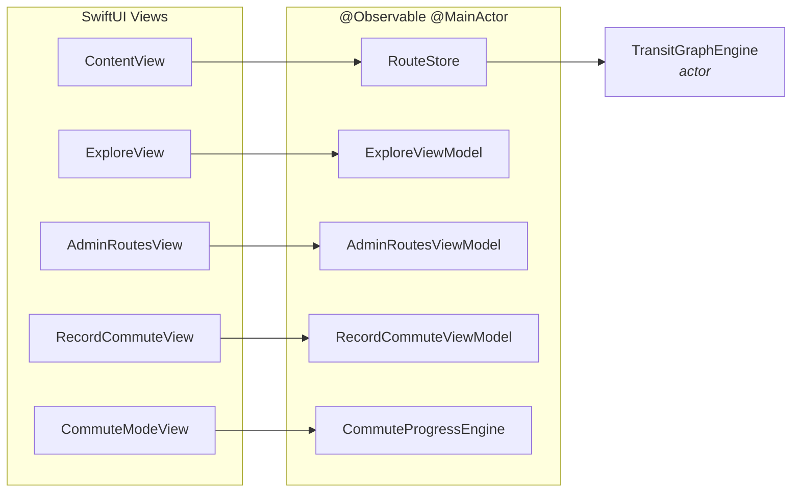
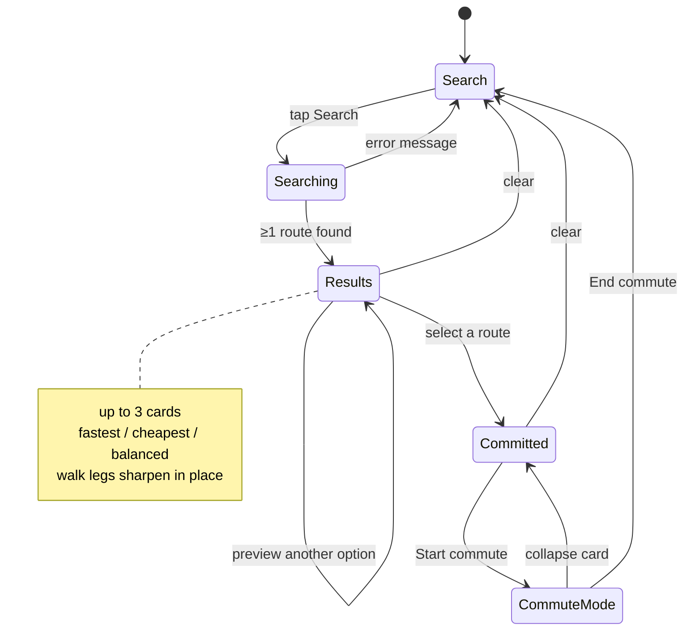

# 5. iOS App

- **Platform**: iOS 26+, Swift 6, SwiftUI, MapKit, Swift Concurrency
- **Dependencies**: none. No SPM packages, no CocoaPods, no linter.
- **Bundle ID**: `com.banaueinc.gora`
- **Product name**: Gora

## Directory layout

```
Gora/
├── GoraApp.swift          @main · UserSession · MainTabView (5 tabs)
├── Domain/
│   └── TransportMode.swift      Note: ~2000 lines — the ENTIRE domain layer
├── Networking/
│   ├── APIClient.swift          shared URLSession, auth header, status→error mapping
│   ├── APIConfig.swift          baseURL
│   ├── APIEndpoint.swift        every endpoint as an enum case (path/method/body)
│   ├── APIError.swift           typed errors
│   └── APIModels.swift          DTOs: APIResponse<T>, UserProfile, GraphVersion, …
├── Services/
│   ├── AuthService.swift        sign in / register / refresh / sign out
│   ├── GraphService.swift       OTA graph version check + download + cache
│   ├── RouteService.swift       route listing endpoints
│   ├── AdminService.swift       admin mutations
│   ├── IncidentService.swift    community incident reports
│   ├── AnalyticsService.swift   fire-and-forget route-plan logging
│   ├── Keychain.swift           JWT storage
│   ├── UserSession.swift        @Observable session + role
│   ├── DirectionsGateway.swift  actor · rate-limits & caches all MKDirections
│   ├── DirectionsTransport.swift
│   └── WalkRouteRefiner.swift   RouteStore extension · post-publish walk sharpening
├── Views/
│   ├── Auth/LoginView.swift
│   ├── Commute/
│   │   ├── ContentView.swift    2631 lines — Commute tab, map, results panel
│   │   └── LocationSearch.swift MKLocalSearchCompleter address suggestions
│   ├── CommuteMode/
│   │   ├── CommuteModeView.swift    follow-along card + 2D/3D camera
│   │   ├── CommuteProgress.swift    CommuteProgressEngine — live leg progress
│   │   └── CommuteLegList.swift
│   ├── Explore/ExploreView.swift    network map + ExploreViewModel
│   ├── Record/
│   │   ├── RecordCommuteView.swift  GPS recording → route creation
│   │   ├── LoopCreatorView.swift    1701 lines — draw/simplify/mark/metadata
│   │   └── PolylineRecorderView.swift
│   └── Settings/SettingsView.swift
├── Admin/
│   ├── AdminRoutesView.swift        route + stop editor
│   ├── AdminEdgesView.swift         edge geometry & directionality
│   ├── AdminService.swift
│   └── StopInsertionPreview.swift
├── Design/
│   ├── DesignTokens.swift           spacing, radii, colours, mode styling
│   └── ColorAssets.swift
├── Debug/DebugRouteSeed.swift
├── Resources/                       Note: empty — graph is downloaded, not bundled
└── Assets.xcassets/
```

### The `TransportMode.swift` problem

The name says "an enum of transport modes". The file actually contains:

- every `Codable` model type (`Station`, `TransitEdge`, `RouteLeg`, `RouteResult`,
  `TransitGraph`, `StationAccessPoint`, …)
- `TransitGraphEngine` — the A\* actor
- `RouteStore` — the main `@Observable` view model
- `GraphLoader`, `StationCache`, `CommuteLocationFetcher`
- `MinHeap`, haversine, `AccessPolicy`, peak-hour logic

If you are looking for domain code and can't find it, it is in this file. Splitting it is a
worthwhile refactor that nobody has done yet.

## MVVM conventions



Rules, enforced by convention (see `.claude/skills/architecture-mvvm.md`):

```swift
// Correct
@Observable
@MainActor
final class MyViewModel { … }

struct MyView: View {
    @State private var vm = MyViewModel()
}

// Never
class MyViewModel: ObservableObject { @Published var … }
struct MyView: View { @StateObject private var vm = … }
```

Session is injected through the environment:

```swift
MainTabView().environment(session)
// …
@Environment(UserSession.self) private var session
```

Models are immutable `Codable` value types. Mutation happens through `with…`-style copy helpers
(e.g. `StationAccessPoint.settingKind(_:)`), not in-place.

## Screen tour

### Commute tab — `ContentView.swift`

The main surface. Full-bleed `Map` with the route drawn as `MapPolyline` per leg, tinted by
`TransportMode.color`, over a bottom sheet that moves through three states:



Notable supporting types in this file: `RouteCardSummary` (line 1237) precomputes card display
data, `RouteResultsPanel` (1418) is the sheet, `ReelSwap` (2044) and `JellyEffect` (2305) are
custom transition/animation modifiers, `RouteLegRow` (2333) renders one leg.

Entering Commute Mode uses `matchedGeometryEffect` with id `"commute-card"` so the selected
`RouteOptionCard` visibly morphs into the `CommuteModeView` card.

### Address search — `LocationSearch.swift`

`AddressSearchService` wraps `MKLocalSearchCompleter`. Suggestions are a
`LocationSuggestion` enum so a *station* result and an *address* result can coexist in one
list — picking a station sets a station ID, picking an address sets a coordinate and routes
through the virtual-node path ([4. Routing Engine](04-routing-engine.md#virtual-nodes-and-access-walks)).

### Commute Mode — `Views/CommuteMode/`

`CommuteProgressEngine` tracks which leg the passenger is on and metres remaining.
`CommuteCameraMode` offers two fixed poses — `twoD` (pitch 0, distance 800) and `threeD`
(pitch 60, distance 300). Neither follows heading: `RouteStore.userLocation` carries no course,
so a heading-aligned camera is future work.

### Explore tab — `ExploreView.swift`

Renders the whole network. `ExploreViewModel` builds `RouteLayer` / `ColoredPolyline` /
`VisibleStation` collections and runs a **road-snapping pass** over edges where
`isRoadSnapped == false`, using MKDirections through `DirectionsGateway` at `.background`
urgency so it can never starve an interactive search.

### Record tab — `Views/Record/`

Three authoring tools; see [9. Authoring & Admin](09-authoring-and-admin.md).

### Admin tab — `Admin/`

Only mounted when `session.isAdmin`. Route/stop editing, edge geometry and directionality, and
graph-wide settings.

## Design system

`Design/DesignTokens.swift` holds spacing, radii and the semantic palette. Mode styling is a
single extension — **use it, don't re-derive colours locally**:

```swift
extension TransportMode {
    var color: Color      // train .blue · bus .orange · jeepney .green
                          // tricycle .purple · walk systemGray
    var icon: String      // tram.fill · bus.fill · bus.fill · bicycle · figure.walk
    var lineWidth: CGFloat // 5 · 4 · 4 · 3 · 2
}
```

Jeepney deliberately shares `bus.fill` with bus — `car.fill` read as a private car, and the
green/orange split keeps them apart.

Access points get their own palette on purpose. A door is not a mode, and colouring doors by
line would make two doors of the same station indistinguishable — which is precisely what the
editor exists to tell apart. `directionTint` colours by `direction`, the field most likely to be
set wrong.

> **Note:** `CLAUDE.md` still carries a "consolidate `modeColor(_:)` before adding more call
> sites" warning. That consolidation is **done** — `DesignTokens.swift:128` is the single
> source, and no `modeColor` function remains in the codebase.

## Swift file header

Every new `.swift` file starts with this, using the exact creation date in `M/D/YY` with no
leading zeros:

```swift
//
//  FileName.swift
//  Gora
//
//  Created by Oscar Allen Brioso on 8/10/26.
//
```

App name is **Gora**. The header goes on line 1, before any `import`.
