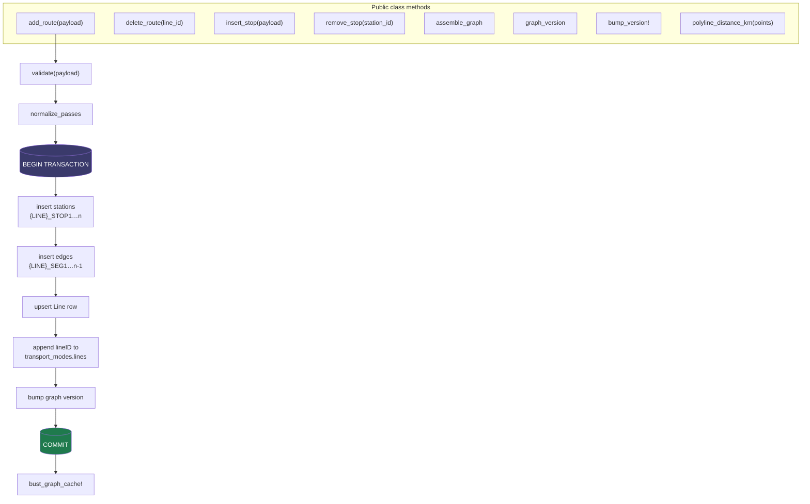
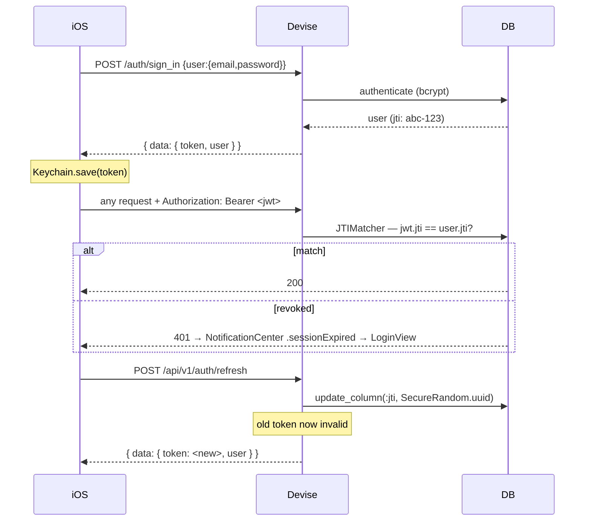

# 6. Backend — `commutebeh-rails`

> **Repository**: `/Users/obiee/Desktop/proj/commutebeh-rails` (separate git repo)
> **Deployed**: `https://commute-backend-a6lj.onrender.com`
>
> **Ignore `CLAUDE-backend.md` and `CLAUDE-web.md` in the iOS repo.** They specify a
> Hono/TypeScript service and a Next.js form that describe an earlier design. The live backend
> is Rails. See [11. Known Issues](11-known-issues.md).

## Stack

| Concern | Choice |
|---|---|
| Language / framework | Ruby 3.4 · Rails 7.1, `--api` mode |
| Server | Puma |
| Database | Postgres (Supabase), `pg_trgm` for fuzzy station search |
| Auth | Devise + devise-jwt, JTIMatcher revocation |
| Cache | Redis via `Rails.cache` |
| Jobs | Sidekiq (Procfile worker) |
| Rate limiting | rack-attack |
| CORS | rack-cors, origins from `ALLOWED_ORIGINS` |
| Object storage | Active Storage → Supabase S3-compatible (AR world maps) |
| Serialization | hand-rolled `as_api_json` on models + `GraphService` |
| Tests | RSpec request specs + service specs |

## Responsibilities

The backend does **not** route. It is:

1. **Identity provider** — register, sign in, refresh, delete account.
2. **Graph authoring API** — create/delete routes, insert/remove stops, edit stations, edges
   and doors, all with domain rules enforced server-side.
3. **Graph distribution** — assemble the whole graph into one JSON document, cache it, version
   it, serve it.
4. **Community + analytics sink** — incidents, saved routes, route-plan events.
5. **AR world map store** — upload/approve `.arworldmap` files anchored to stations.

## Layout

```
commutebeh-rails/
├── app/
│   ├── controllers/
│   │   ├── health_controller.rb
│   │   └── api/v1/
│   │       ├── base_controller.rb        auth, json_response, error_response, cache busting
│   │       ├── graph_controller.rb       GET /graph, /graph/version   (public)
│   │       ├── stations_controller.rb    GET /stations, /stations/:id (public)
│   │       ├── routes_controller.rb      GET /routes, /routes/:line_id (public)
│   │       ├── saved_routes_controller.rb
│   │       ├── incidents_controller.rb
│   │       ├── analytics_controller.rb
│   │       ├── users_controller.rb
│   │       ├── ar_world_maps_controller.rb
│   │       ├── auth/{sessions,registrations}_controller.rb
│   │       └── admin/
│   │           ├── graph_controller.rb    create_route / delete_route
│   │           ├── stations_controller.rb create / update / destroy
│   │           ├── edges_controller.rb    update geometry + directionality
│   │           ├── settings_controller.rb enforce_operating_hours
│   │           └── analytics_controller.rb summary / hotspots
│   ├── models/                            15 models — see 03-data-model.md
│   └── services/
│       └── graph_service.rb               Note: 1141 lines — all graph mutation logic
├── db/migrate/                            001 … 019
├── spec/                                  request + service specs
├── config/routes.rb
├── render.yaml · Procfile · railway.toml
└── Gemfile
```

## `GraphService` — the core

`app/services/graph_service.rb`. Every graph mutation goes through it, wrapped in a transaction,
and every mutation bumps `graph_meta.version`.



### `assemble_graph`

Builds the client-facing document. Two details matter:

- `Station.includes(:access_points)` — without the preload this is one query per station on a
  payload that already assembles the whole graph in one request.
- Output keys are **camelCase**, unlike every other endpoint. That is what lets `GraphLoader`
  decode it with a plain `JSONDecoder`.

### `insert_stop` / `remove_stop` — deliberately narrow

These renumber a line's `_STOP<n>` / `_SEG<n>` chain, which is only well-defined under strict
conditions. From `graph_service.rb:328`:

| Rule | Why |
|---|---|
| Never on `mode == "train"` | MRT/LRT stations are shared by both directions' edges. Splitting one direction's edge leaves the other silently bypassing the change — an asymmetric graph. |
| Never on a closed loop | The closing edge is real recorded geometry between two specific endpoints; if a terminal shifts there is no principled way to auto-repair it. Detected via `edge_count >= station_count`. |
| Only on `<prefix>_STOP<n>` stations | That convention is what makes sequential renumbering well-defined. Hand-authored named stations (trains) don't use it and are excluded by rule 1 anyway. |

**Accepted tradeoff:** renumbering touches `stations` and `edges` only. It does not chase
station/edge IDs held as strings in `saved_routes`, `route_plan_events`, `ar_world_maps` or
`incidents` — there is no DB-level FK, so a renumbered ID can leave those dangling. Renumbering
was chosen over stable IDs.

### Validation (`add_route`)

`LINE_ID_RE` permits uppercase letters, digits, underscores and dots — e.g.
`STACRUZ.LRT_BUENDIA`. Errors come back as a `{ field:, message: }` array.

| Check | Message |
|---|---|
| `displayName` blank | "Display name is required."|
| `lineID` blank | "Line ID is required."|
| `lineID` contains a space | "Line ID must not contain spaces."|
| `lineID` fails `LINE_ID_RE` | "Line ID must only contain uppercase letters, digits, underscores, and dots."|
| `lineID` already has stations | *Conditional* — see below |
| `mode` not in `transport_modes` | invalid mode |
| fewer than 2 stops | at least 2 required |
| `crowdFactor` / `reliability` outside 0–1 | range error |

An existing `lineID` is **not** an automatic rejection: it is also the path for adding the
missing northbound/southbound direction to a route that already has the other one.
`existing_line_append_error` decides which case it actually is.

### Multi-pass payloads

`normalize_passes` accepts both the legacy flat `stops:` array and the newer multi-pass shape
used by the iOS Loop Creator:

```jsonc
{
  "passes": [
    { "direction": "northbound", "stops": [...], "closesLoop": false },
    { "direction": "southbound", "stops": [...], "closesLoop": true,
      "closingPolyline": [{lat, lng}, … ] }
  ]
}
```

## Auth



Revocation is **JTIMatcher**: one live token per user. Refresh rotates the JTI, so the previous
token dies immediately. `update_column` writes through to the in-memory attribute, so the
`UserEncoder.call` on the next line signs the *new* JTI — a detail that would silently produce
dead tokens if it didn't.

Roles: `users.role` enum, `commuter: 0` / `admin: 1`. `require_admin!` in `BaseController` gates
the whole admin namespace with a 403.

Public endpoints call `skip_before_action :authenticate_user!` — currently `graph`, `stations`,
`routes` and `health`.

## Caching

| Key | TTL | Busted by |
|---|---|---|
| `full_graph` | 5 min | `bust_graph_cache!` on any admin write |
| `graph_version` | 30 s | same |
| `routes_index` | 30 min | pattern bust |
| `stations/<line>/<type>/<interchange>/<search>` | 1 hour | pattern bust |

`bust_graph_cache!` (`base_controller.rb:40`) rescues everything and logs. This is a fix for a
live bug: every admin write called `Rails.cache.delete` unprotected *after* the DB transaction
had committed, so a Redis blip surfaced as a raw 500 to the client even though the write had
succeeded. Worst case now is briefly stale cache until the TTL expires — much better than a
false failure.

## Deployment

`render.yaml`:

```yaml
type: web · runtime: ruby · region: singapore · plan: starter
buildCommand:     bundle install
preDeployCommand: bundle exec rails db:migrate
startCommand:     bundle exec puma -C config/puma.rb
healthCheckPath:  /health
```

Environment variables: `DATABASE_URL`, `SECRET_KEY_BASE` (generated), `DEVISE_JWT_SECRET_KEY`,
`REDIS_URL`, `ALLOWED_ORIGINS`, `SUPABASE_S3_*`, `SUPABASE_STORAGE_BUCKET`,
`RAILS_SKIP_ASSET_COMPILATION=true`.

### Two operational facts worth memorising

1. **The `starter` plan spins down on idle.** A cold request takes roughly 44 seconds. If the
   app appears to hang on first launch, this is usually why — not a client bug.
2. **Seeds never run on deploy.** The start command runs `db:migrate` only. Anything the app
   requires to *function* must live in a migration, not `seeds.rb`. This was discovered the hard
   way: production had an empty `graph_meta` and no admin user. Migration
   `011_bootstrap_admin_and_graph_meta.rb` exists specifically to create the `GraphMeta` row and
   bootstrap admin accounts.

## Migration history

| # | What it did |
|---|---|
| 001–008 | extensions, users, saved routes, AR maps, route plan events, incidents, Active Storage, trigram search indexes |
| 009 | **graph tables** — `graph_meta`, `transport_modes`, `payment_methods`, `peak_hour_config`, `fare_matrix`, `stations`, `edges` |
| 010, 012 | `enforce_operating_hours` on `graph_meta` |
| 011 | bootstrap admin user + `GraphMeta` row (see above) |
| 013, 015 | `is_road_snapped` on edges + backfill for dense polylines |
| 014 | real primary keys on graph tables |
| 016 | corrected rail station coordinates |
| 017 | `station_access_points` (station doors) |
| 018, 019 | `lines` table + version bump so clients re-sync |

Read this table as a changelog of the data model: doors and named lines are recent additions,
which is why the client decodes both defensively.
