# 7. API Reference

**Base URL**: `https://commute-backend-a6lj.onrender.com`
Configured client-side at `Gora/Networking/APIConfig.swift:11`; a commented-out
`http://localhost:3000` sits beside it for local work.

Every client call is constructed in `Gora/Networking/APIEndpoint.swift` — one enum case
per endpoint, carrying its own path, method and body. That file is the practical index of what
the app actually calls.

## Conventions

### Envelopes

Successful authenticated responses wrap the payload:

```json
{ "data": { … }, "meta": { "count": 42 } }
```

Decoded client-side by `APIResponse<T>` (`APIModels.swift:11`). `meta` is present only when the
controller supplies it.

Errors:

```json
{ "error": "Validation failed", "errors": ["Name can't be blank"] }
```

### Case conventions — read carefully

| Surface | Case | Client decoder |
|---|---|---|
| Everything except the graph document | `snake_case` | `APIClient`'s decoder with `.convertFromSnakeCase` |
| The graph document from `GET /api/v1/graph` | `camelCase` | plain `JSONDecoder` in `GraphLoader` |

Both are live at once. Adding a field means checking which side of the line you're on.

### Auth

`Authorization: Bearer <jwt>` on every request, attached automatically by `APIClient` when a
token is in the Keychain. A `401` posts `Notification.Name.sessionExpired` before throwing —
`UserSession` observes it and forces sign-out.

### Status codes

| Code | `APIError` case | Client behaviour |
|---|---|---|
| 200–299 | — | decode `T` |
| 401 | `.unauthorized` | post `.sessionExpired`, sign out |
| 403 | `.forbidden` | admin-only endpoint |
| 404 | `.notFound` | |
| 422 | `.unprocessable(String)` | parses `error` + `errors[]` into one message |
| 429 | `.tooManyRequests` | rack-attack |
| other | `.serverError(Int)` | |

## Endpoint map

```mermaid
graph LR
    subgraph pub["Public"]
        H["GET /health"]
        GV["GET /api/v1/graph/version"]
        G["GET /api/v1/graph"]
        ST["GET /api/v1/stations"]
        ST1["GET /api/v1/stations/:id"]
        RT["GET /api/v1/routes"]
        RT1["GET /api/v1/routes/:line_id"]
    end
    subgraph auth["Authenticated"]
        REG["POST /auth/register"]
        SI["POST /auth/sign_in"]
        SO["DELETE /auth/sign_out"]
        RF["POST /api/v1/auth/refresh"]
        DA["DELETE /api/v1/auth/account"]
        ME["GET · PATCH /api/v1/me"]
        SR["GET · POST · DELETE /api/v1/saved_routes"]
        INC["GET · POST /api/v1/incidents"]
        AN["POST /api/v1/analytics/route_plan"]
        AR["/api/v1/ar_world_maps"]
    end
    subgraph adm["Admin only"]
        AGC["POST /api/v1/admin/graph/routes"]
        AGD["DELETE /api/v1/admin/graph/routes/:line_id"]
        ASC["POST · PATCH · DELETE /api/v1/admin/stations"]
        AEC["PATCH /api/v1/admin/edges/:id"]
        ASE["GET · PATCH /api/v1/admin/settings"]
        AAN["GET /api/v1/admin/analytics/{summary,hotspots}"]
        AU["/api/v1/admin/users"]
    end

    style pub fill:#1f4d33
    style auth fill:#1f3a5f
    style adm fill:#5f2b1f
```



---

## Auth

### `POST /auth/register`

```json
{ "user": { "email": "…", "password": "…",
            "password_confirmation": "…", "display_name": "…"} }
```
→ `{ "data": { "token": "eyJ…", "user": { id, email, display_name, role } } }`

### `POST /auth/sign_in`

```json
{ "user": { "email": "…", "password": "…"} }
```
→ same shape. `401 { "error": "Invalid email or password"}` on failure.

### `POST /api/v1/auth/refresh`

No body. Rotates the user's JTI — **the token used to make this call is dead afterwards** — and
returns a fresh one. Called on app launch by `UserSession.refreshSession()`.

### `DELETE /auth/sign_out`

Revokes server-side, clears the Keychain client-side.

### `DELETE /api/v1/auth/account`

Full account deletion. Present for App Store compliance.

## User

| Method | Path | Notes |
|---|---|---|
| `GET` | `/api/v1/me` | Current profile |
| `PATCH` | `/api/v1/me` | Body `{ "user": { "display_name": …, "home_station_id": … } }` |

## Graph

### `GET /api/v1/graph/version` · public

```json
{ "data": { "version": 42, "lastModified": "2026-08-10T09:12:33Z",
            "stationCount": 60, "edgeCount": 76 } }
```

Cheap poll. The client checks this before deciding to download the full graph. Cached 30 s.

> `version` is an **Int** here. `GraphVersion` (`APIModels.swift:96`) has a custom
> `init(from:)` that accepts Int or String and normalises to String — otherwise OTA sync breaks
> on a type mismatch.

### `GET /api/v1/graph` · public

The entire graph document — see [3. Data Model](03-data-model.md#the-json-document). camelCase.
Cached 5 minutes. Returns `503 { "error": "Graph unavailable", "message": … }` if assembly
fails.

## Stations · public

### `GET /api/v1/stations`

Query params: `line`, `type`, `interchange=true`, `search` (trigram-backed `ILIKE` over name /
short name / line). Cached 1 hour per parameter combination.

→ `{ "data": […station… ], "meta": { "count": n } }`

### `GET /api/v1/stations/:id`

`:id` accepts dots (`GRAPH_ID` constraint).

## Routes (lines) · public

### `GET /api/v1/routes`

One entry per line: `line_id`, `mode`, `base_fare`, `accepted_payments`,
`is_air_conditioned`, `crowd_factor`, `reliability`, `stop_count`. Optional `mode` and `search`
filters, applied in Ruby after the cached fetch.

### `GET /api/v1/routes/:line_id`

Full detail — line metadata plus every station and edge on it. `404` if the line has no
stations.

## Saved routes

| Method | Path | Body |
|---|---|---|
| `GET` | `/api/v1/saved_routes` | — |
| `POST` | `/api/v1/saved_routes` | `{ "saved_route": { name, origin_station_id, destination_station_id, line_ids } }` |
| `DELETE` | `/api/v1/saved_routes/:id` | — |

## Incidents

| Method | Path | Notes |
|---|---|---|
| `GET` | `/api/v1/incidents` | Active only — `expires_at IS NULL OR > now()` |
| `POST` | `/api/v1/incidents` | `{ "incident": { station_id, description, category } }` |

`category` ∈ `delay` · `crowding` · `breakdown` · `closure` · `other`.

## Analytics

### `POST /api/v1/analytics/route_plan`

```json
{ "event": { "origin_station_id": "…", "destination_station_id": "…",
             "line_ids": ["MRT-3"], "duration_seconds": 1860 } }
```

Always returns `201 { "message": "Logged"}` — **even on failure**. The controller rescues
everything and logs a warning, deliberately: an analytics failure must never block someone's
commute. Server-side, `duration_seconds` is converted to `total_time_minutes` (ceil) and
`line_ids` is stored in `modes_used`.

Sent client-side via `APIClient.send(_:)`, a fire-and-forget variant that never blocks and
discards the response.

> **Drift:** an earlier audit found `AnalyticsService.logRoutePlan` had zero call sites.
> Verify before relying on this data.

## AR world maps

| Method | Path | Notes |
|---|---|---|
| `GET` | `/api/v1/ar_world_maps` | Approved only for non-admins |
| `GET` | `/api/v1/ar_world_maps/:id` | Includes a signed download URL |
| `POST` | `/api/v1/ar_world_maps` | Multipart — `.arworldmap` via Active Storage |
| `POST` | `/api/v1/ar_world_maps/:id/relocalize` | |

Status enum: `pending` · `approved` · `rejected`.

---

## Admin endpoints

All require `role == admin`; otherwise
`403 { "error": "Forbidden", "message": "Admin access required"}`.

### `POST /api/v1/admin/graph/routes`

Creates a whole line. Body — either the flat form or the multi-pass form:

```jsonc
{
  "displayName": "UPLB Kanan",
  "lineID": "UPLB_KANAN",
  "mode": "jeepney",
  "isAirConditioned": false,
  "baseFare": 13, "farePerKm": 1.8,
  "acceptedPayments": ["cash"],
  "openTime": "05:00", "closeTime": "22:00",
  "crowdFactor": 0.7, "reliability": 0.65,

  // either:
  "stops": [{ "name": "…", "shortName": "…", "lat": 14.16, "lng": 121.24 }, … ],
  // or:
  "passes": [
    { "direction": "northbound", "stops": [… ], "closesLoop": false },
    { "direction": "southbound", "stops": [… ], "closesLoop": true,
      "closingPolyline": [{ "lat": …, "lng": … } ] }
  ]
}
```

→ `{ "data": { "lineId": "UPLB_KANAN", "stationsAdded": 12, "edgesAdded": 11 } }`

Generated IDs: stations `{lineID}_STOP1…n`, edges `{lineID}_SEG1…n-1`. `isTerminal` is decided
server-side from stop index — never trusted from the client.

### `DELETE /api/v1/admin/graph/routes/:line_id`

Removes the line's stations, edges and `lines` row, and detaches the ID from
`transport_modes.lines`. `:line_id` may contain dots.

### `POST /api/v1/admin/stations`

Inserts one stop into an existing line, splitting or extending the edge chain and renumbering
the `_STOP<n>` / `_SEG<n>` sequence. Subject to the three narrowing rules in
[6. Backend](06-backend.md#insert_stop--remove_stop--deliberately-narrow).

→ `{ "data": { "lineId": "…", "stationId": "…"} }`

### `PATCH /api/v1/admin/stations/:id`

```jsonc
{ "station": {
    "latitude": 14.1642, "longitude": 121.2413,
    "name": "…", "short_name": "…",
    "open_time": "05:00", "close_time": "22:00",
    "access_points": [
      { "access_point_id": "…", "name": "North gate", "kind": "entrance",
        "direction": null, "lat": …, "lng": … }
    ]
} }
```

Every field is optional; only what changed is sent (`StationUpdate` in `APIModels.swift:52`).

**`access_points` semantics — important.** The array **replaces** the station's entire door set.
A door left out is a door deleted; that is how removal works. Omitting the key entirely leaves
the server's doors untouched, so renaming a station or nudging its centroid doesn't have to
resend them. An explicit `[]` clears them. `direction` must be sent as JSON `null` (not omitted)
to mean "serves every direction"— the key has to arrive for the server to write NULL.

### `DELETE /api/v1/admin/stations/:id`

Removes a stop and merges its two adjacent edges — or drops the single adjacent edge if it was a
terminal.

### `PATCH /api/v1/admin/edges/:id`

```jsonc
{ "edge": {
    "polyline_coordinates": [{ "lat": …, "lng": … }, … ],
    "bidirectional": true,
    "direction": "northbound"// or null to clear
} }
```

Each field applies independently, so a directionality edit must not rewrite geometry. The client
models `direction` as a **double optional** for exactly this: `.some(nil)` clears the label,
`.none` leaves it alone (`APIEndpoint.swift:169`). When `polyline_coordinates` is supplied the
server recomputes `distance_km` via `GraphService.polyline_distance_km`.

### `GET` / `PATCH /api/v1/admin/settings`

```json
{ "data": { "enforce_operating_hours": true } }
```

A graph-wide switch. When false, A\* skips every station operating-hours check. Changing it
busts the graph cache and bumps the version, so clients re-sync.

### `GET /api/v1/admin/analytics/summary` · `/hotspots`

Aggregates over `route_plan_events`.

### `/api/v1/admin/users`, `/admin/incidents`, `/admin/ar_world_maps`

Standard index / show / update / destroy moderation endpoints.

## Health

`GET /health` — unauthenticated, used by Render's health check and UptimeRobot.
