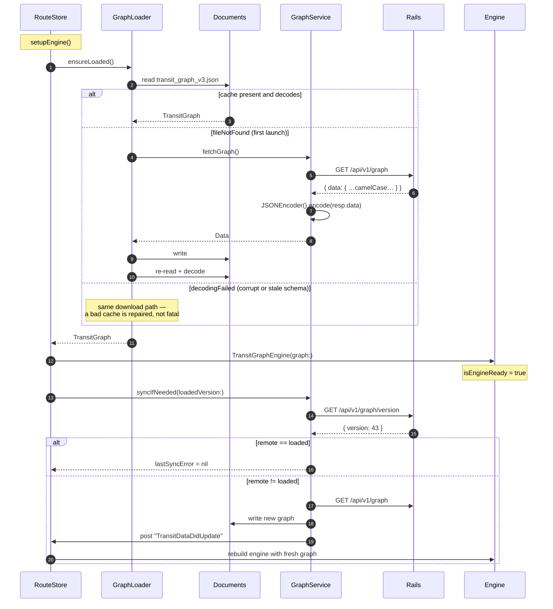
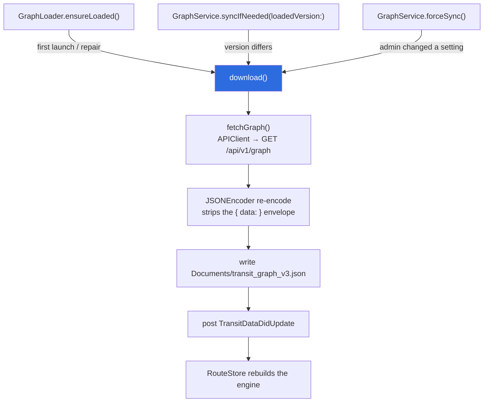

# 8. Graph Sync

The transit graph is **not bundled with the app**. `Gora/Resources/` is empty. The only
copy on device is downloaded from the backend and cached in `Documents/`. This is what lets an
admin add a jeepney route and have every user routing over it without an App Store release.

It also means: **a first launch with no network cannot route at all**, and a cache that fails to
decode has no bundle to fall back to.

## Storage

| File | Written by | Purpose |
|---|---|---|
| `Documents/transit_graph_v3.json` | `GraphLoader` / `GraphService` | The graph. Re-encoded camelCase. |
| `Documents/stations_cache.json` | `StationCache` | Lightweight `[Station]` for instant search-as-you-type before the engine finishes async setup. |
| Keychain | `Keychain.swift` | JWT |
| `UserDefaults["com.banaueinc.gora.userProfile"]` | `UserSession` | Cached profile for optimistic launch |

## Lifecycle



## Version check

`graph_meta.version` is an integer bumped on every mutation. The client compares it as a
**String** — `GraphVersion.init(from:)` accepts Int or String and normalises, because the server
sends Int in the version endpoint while a locally re-encoded graph stores String.

The comparison is `!=`, not `<`. A rollback on the server (version going *down*) still triggers
a re-download, which is the desired behaviour.

## Two paths, one destination



`forceSync()` exists for the case where an admin toggles `enforce_operating_hours`: the server
bumps the version, but the app shouldn't wait for the next natural poll to reflect a setting the
admin just changed.

## Failure handling

Sync never throws to the caller. Every failure path routes through `GraphService.fail(_:)`,
which records a reason on `lastSyncError` and logs it:

```swift
private func fail(_ reason: String) -> Bool {
    lastSyncError = reason
    log.error("Graph sync \(reason) — continuing on the cached graph")
    return false
}
```

The reasons are distinct on purpose: `"version check failed: …"`, `"download failed: …"`,
`"cache write failed: …"`, `"no Documents directory to cache the graph in"`.

The rationale, from `Services/GraphService.swift:19`: a failed sync leaves the app routing on
whatever graph is already in Documents, and **a stale graph is indistinguishable from a genuine
routing failure** — "no route found" for a trip a newer graph covers. Recording *why* is what
makes the two tellable apart. The admin screen surfaces `lastSyncError`; the log line carries it
regardless.

Filter the logs with:

```bash
log stream --predicate 'subsystem == "com.banaueinc.gora" AND category == "GraphSync"'
```

## Schema evolution rules

Because a cached graph on a user's device may predate any change you make:

1. **New fields must be optional client-side.** Use `decodeIfPresent` with a safe default, the
   way `lines` (→ `[:]`) and `enforceOperatingHours` (→ `true`) do.
2. **A required field added carelessly bricks every cached graph in the field.** The old cache
   fails to decode; `ensureLoaded` treats that as repairable and re-downloads — so the failure
   mode is recoverable *if the user has network*, and a hard stop if they don't.
3. **Bump the graph version on the server** when you change the emitted shape, so clients pull
   the new document instead of waiting for a TTL. Migration 019 exists purely to do that after
   the `lines` table landed.
4. **Watch the envelope.** `fetchGraph()` unwraps `{ "data": … }` via `APIResponse<TransitGraph>`
   and re-encodes the inner value. Writing the raw response body to Documents instead would
   store the envelope, and `GraphLoader` — which has no bundle fallback — would fail to decode
   it on every subsequent launch.

## Cache TTLs on the server

| Key | TTL |
|---|---|
| `graph_version` | 30 s |
| `full_graph` | 5 min |

Admin writes call `bust_graph_cache!`, so an authored change is visible immediately rather than
after the TTL. If a Redis blip swallows the bust, the TTL is the backstop — see
[6. Backend § Caching](06-backend.md#caching).
