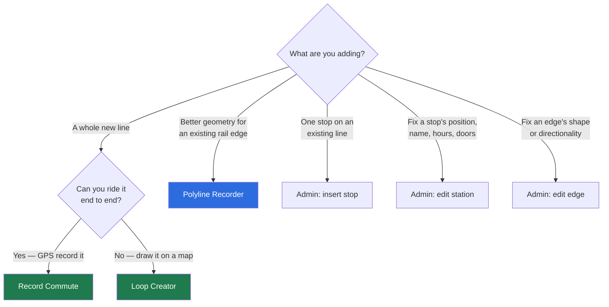
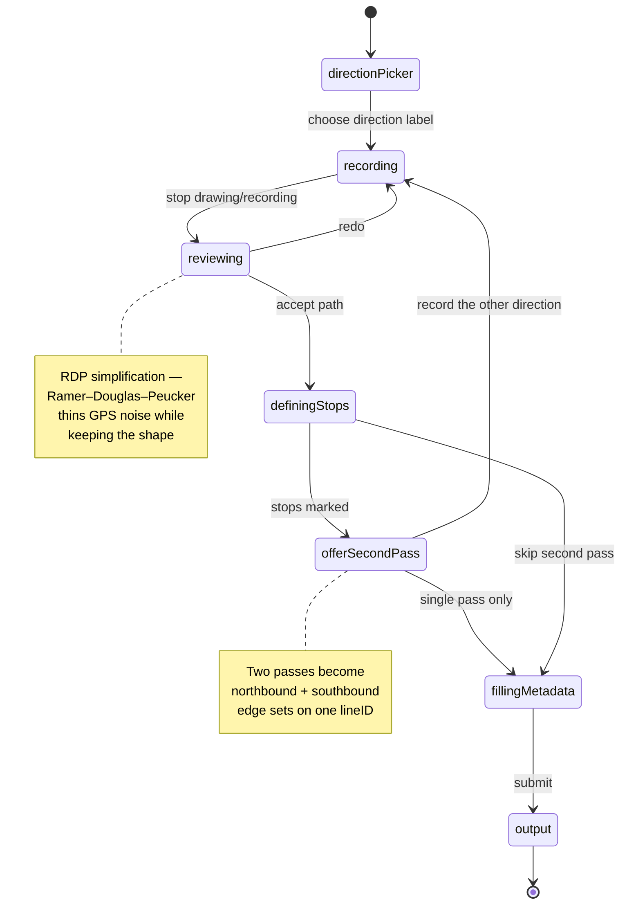
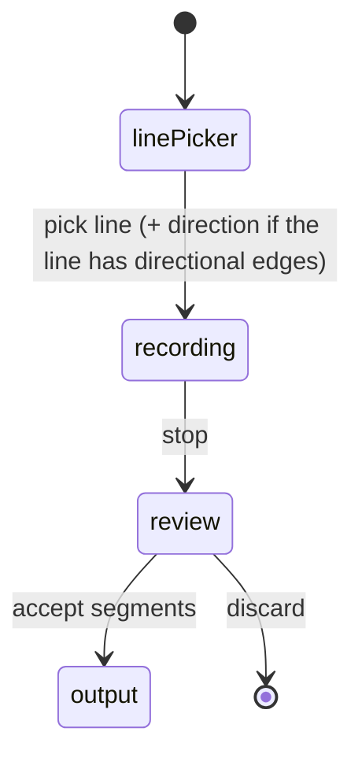
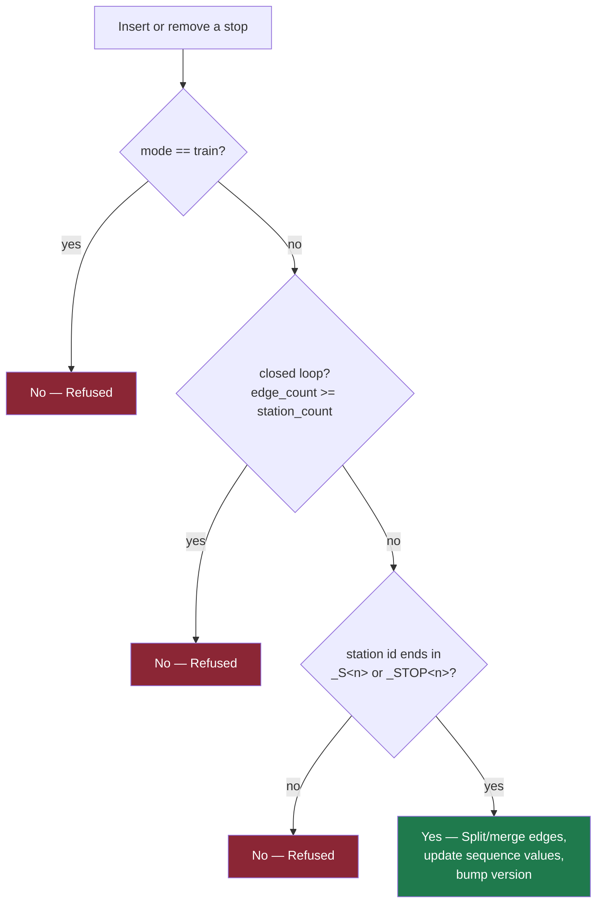
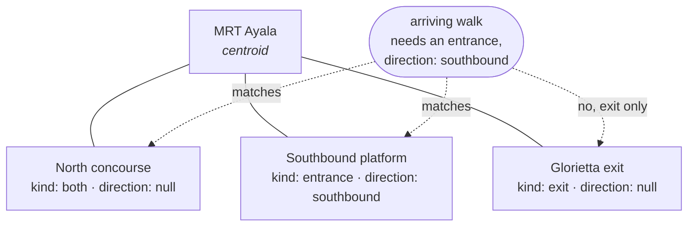
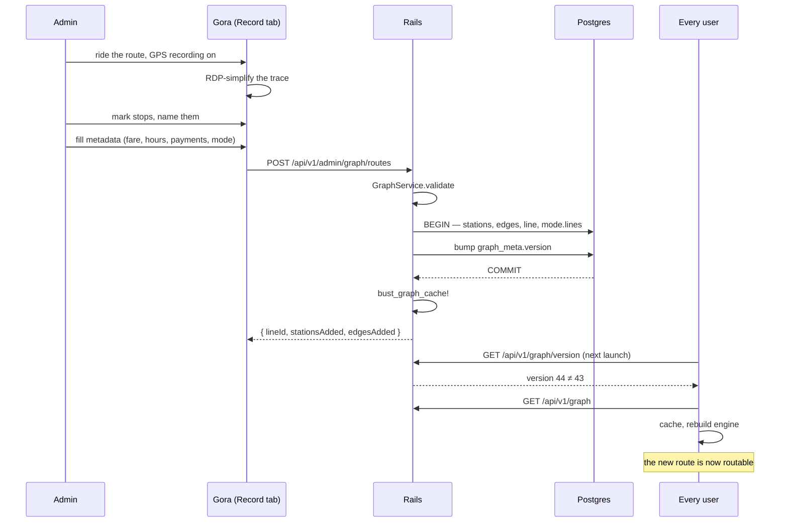

# 9. Authoring & Admin

Metro Manila's jeepney and tricycle network is in no public feed, so Gora ships the tools to
survey it. This page covers the three authoring flows and the admin editor, plus the rules that
constrain what can safely be edited.

## Which tool for which job



---

## Loop Creator — `Views/Record/LoopCreatorView.swift`

The most capable authoring tool, and the one that produces multi-pass (two-direction) routes.
1701 lines; the model is `CreateLoopViewModel`.



**RDP simplification** (`LoopCreatorView.swift:30`) is standard Ramer–Douglas–Peucker: find the
point furthest from the chord, recurse if it exceeds epsilon, otherwise collapse to the
endpoints. A raw GPS trace has hundreds of points; the stored polyline needs tens.

**Closed loops.** A route whose last stop connects back to the first has a `closesLoop` flag and
a `closingPolyline`. That closing edge is *real recorded geometry between two specific
endpoints*, which is precisely why insert/remove stop refuses to operate on loops — there is no
principled way to auto-repair it when a terminal moves.

**Line ID generation.** Display Name → uppercase, split on whitespace, join with `_`, strip
anything outside `[A-Z0-9_]`. Auto-updates as you type until you manually edit the Line ID, then
stops.

## Record Commute — `Views/Record/RecordCommuteView.swift`

GPS-record a ride you are actually on, then convert the trace into a route. Two view models:
`RecordCommuteViewModel` (a `CLLocationManagerDelegate` handling the live trace) and
`RecordedRouteCreatorViewModel` (the trace → route conversion).

Produces **linear, bidirectional** routes — `stop[i] → stop[i+1]`, no wraparound — which is the
difference from Loop Creator.

Derived values match the backend's own port of this logic:

```
distanceKm  = haversine(from, to)
travelTime  = max(2.0, distanceKm / 0.4)      // ≈24 km/h, floor of 2 minutes
```

## Polyline Recorder — `Views/Record/PolylineRecorderView.swift`

Different purpose: it does not create a line, it improves the **geometry of edges that already
exist**. Ride MRT-3, record the trace, and each GPS segment is matched to a stored edge and
staged for review.



Three details that are easy to get wrong and are already handled:

- **Nothing uploads until the rider explicitly accepts it** in the review phase. Segments with
  an obviously-wrong match — a dropped signal, a mis-tapped direction — are flagged so review
  can catch them.
- **Directional vs bidirectional lines.** MRT-3 matches on `from`/`to`/`direction` exactly.
  LRT-1 and LRT-2 have a single physical edge per station pair; if the ride crossed it in the
  opposite direction from how it's stored, the recorded points are **reversed** before upload so
  the polyline still starts at `edge.from` and ends at `edge.to`. That is a schema invariant, not
  a preference. The direction prompt is skipped entirely for such lines.
- **Background location.** `allowsBackgroundLocationUpdates` requires `.authorizedAlways`;
  setting it under any other status throws a `CLClientIsBackgroundable` invalid-parameter crash.
  The code reads `locationManager.authorizationStatus` **live** rather than a cached property,
  because the cache only refreshes asynchronously from `didChangeAuthorization` and can read
  `.authorizedAlways` for a moment after the OS has already revoked it — exactly the stale state
  that trips the assertion.

---

## Admin editor — `Admin/`

Mounted only when `session.isAdmin`.

| View | Edits |
|---|---|
| `AdminRoutesView.swift` | Lines, stations, stop insertion/removal, graph settings |
| `AdminEdgesView.swift` | Edge polyline geometry, `bidirectional`, `direction` |
| `StopInsertionPreview.swift` | Visual preview of where a new stop will split the chain |

### Insert / remove stop — the three rules

Server-enforced in `GraphService`, and the client mirrors them so the UI doesn't offer an
operation that will be rejected.



| Rule | Reason |
|---|---|
| Never on `train` | MRT/LRT stations are shared by both directions' edges. Splitting one direction's edge leaves the other silently bypassing the change — an asymmetric graph. |
| Never on a closed loop | The closing edge is real recorded geometry; there's no principled auto-repair when a terminal shifts. |
| Only `<chain>_S<n>` or `<chain>_STOP<n>` stations | The suffix names the chain. Hand-authored named stations (trains) have no chain and are excluded by rule 1 anyway. |

**Chain order.** `StationChain` (`Domain/StationChain.swift`) is the one place that reads a
chain from an id. The chain is the part of the id before a trailing `_S<n>` (new) or
`_STOP<n>` (legacy). Stops sort by `Station.sequence`. A station without `sequence` sorts by its
legacy `_STOP<n>` number, then by input order. A new stop id is `<chain>_S<n>`, with `n` one
above the larger of the line's `lastStopNumber` and the highest `_S<n>` among all stations of the line. The number is unique across the chains of a line. A graph without `lastStopNumber` uses the highest station number alone. A new line edge id is `<FROM>__<TO>`. A chain is a
closed loop when an edge runs from its last stop to its first stop.

An insert or a removal changes `sequence` values only. No station id or edge id is renamed, so
the tables that store station ids as bare strings keep pointing at the same stop.

### Station doors (access points)

A station can carry any number of doors, each with a name, a `kind`
(`entrance` / `exit` / `both`), an optional `direction`, and its own coordinates. Routing
measures walks to the appropriate door rather than the station centroid.



Selection rules, implemented once on each side (`StationAccessPoint.serving` scope server-side,
`Station.accessPoint(kind:direction:near:)` client-side):

- `direction: NULL` means **serves every direction** and matches any request — so a station with
  one shared concourse is a single NULL row needing no special handling.
- `kind: both` answers to entrance and exit alike — the usual single-hall station is one row,
  not two.
- A **`nil` requested direction** means the caller doesn't know or doesn't care (an LRT leg, or a
  walk whose adjoining ride carries no direction label). It must return **every** door. Filtering
  to `direction IS NULL` would make a station whose doors are all direction-tagged look like it
  had none, and it would fall back to the centroid while perfectly good coordinates sat in the
  table.
- **No doors is a legitimate answer** — it means "not surveyed yet", and the caller falls back to
  the centroid.
- Ties break on nearest.

**Editing semantics — the sharp edge.** `PATCH /admin/stations/:id` with `access_points`
**replaces the whole set**. A door left out is a door deleted; that is how removal works, and why
the editor always sends the full list rather than a diff. Omit the key entirely to leave doors
untouched. Send `[]` to clear them. Send `direction: null` explicitly — omitting the key means
the server can't write NULL.

### Edge editing

Geometry, `bidirectional` and `direction` apply **independently**. Editing directionality must
not rewrite geometry, which is why the client sends only what changed and models `direction` as
a double optional: `.some(nil)` clears the label, `.none` leaves it alone. When geometry is sent,
the server recomputes `distance_km` from the polyline.

### Graph settings

`enforce_operating_hours` is the one graph-wide switch. Off, A\* skips every station
operating-hours check — useful when hours data is incomplete and legitimate routes are being
filtered out. Toggling it bumps the graph version and busts the cache, and the client calls
`forceSync()` so the change takes effect without waiting for a poll.

---

## End-to-end: adding a jeepney route



No App Store release involved. That is the whole point of the OTA design.
